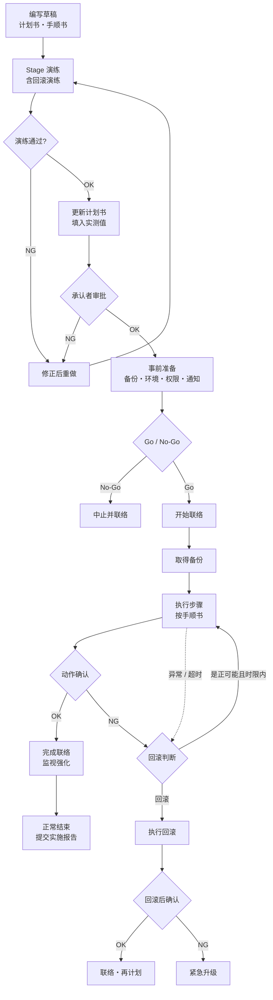

# 本番計画書的常见结构

## 1. 计划书与手顺书的区别

| 文档 | 回答的问题 | 读者 | 内容 |
|---|---|---|---|
| 本番計画書 | 做什么、谁来做、什么条件下做、不行怎么退 | 审批者 | 范围、日程、体制、影响、风险、回滚判断 |
| 手顺書 | 具体敲什么命令、点哪个画面 | 实施者 | 针对这一次变更逐步写出的操作 |

- 命令和操作细节只写在手顺书里。计划书第 7 章只写大步骤，并引用手顺书的编号。
- 回滚手顺书也要针对这次变更单独写。

## 2. 计划书的 12 章

右侧一列是"草稿阶段"（Stage 演练之前）的写法：能直接写的现在写；需要实测数值的先写框架，数值留空，演练后再填。

| 章 | 内容 | 草稿阶段 |
|---|---|---|
| 1. 概要 | 变更名称、目的、背景、对象系统 | 现在写 |
| 2. 实施范围 | 变更内容，以及明确不在范围内的内容 | 现在写 |
| 3. 实施日程 | 事前准备、实施窗口（开始/结束时间）、事后确认 | 先写阶段和顺序，窗口时长演练后补 |
| 4. 体制与职责 | 实施负责人、确认者、审批者、联络窗口、紧急联络网 | 现在写 |
| 5. 影响分析 | 对用户和业务的影响、停止时间、关联系统 | 现在写 |
| 6. 事前准备事项 | 备份、环境确认、权限、事前通知 | 现在写 |
| 7. 实施步骤概要 | 只写大步骤，详细内容引用手顺书 | 先写大步骤，"所需时间"和"不可逆点"演练后补 |
| 8. 确认项目 | 实施后的动作确认标准、判定基准 | 先列确认项和暂定基准，演练时验证是否可行 |
| 9. 风险与对策 | 想定风险、发生概率与影响度、对应策略 | 现在写，必须包含"stage 与本番的差异" |
| 10. 回滚计划（切り戻し） | 判断基准（何时决定回滚）、判断者、回滚步骤、所需时间 | 先写判断条件和步骤，"所需时间"和"最终回滚判断时刻"演练后补 |
| 11. 联络与报告 | 开始、完成、异常时向谁、通过什么渠道联络 | 现在写 |
| 12. 附件 | 手顺书、检查表、联络先一览 | 现在写（放链接） |

草稿阶段不要求每一项都填满，但 12 章的框架要齐。这样演练时才知道要记录什么，演练后再填入实测值。

### 建议补充（不在上面的基本结构里，但审批时常被问到）

- 第 6 章：写明 Go / No-Go 的判定条件和判定者。
- 第 10 章：把"中止"（开始前决定不做）和"切り戻し"（开始后退回去）分开写。
- 第 8 章：写明实施后的监视强化期间、监视担当和结束条件。
- 第 3 章：确认同一时间窗内有没有其他变更、有没有发布冻结期。

## 3. 手顺书

### 每一步通常包含

1. 步骤编号
2. 具体操作（命令或画面操作）
3. 预期结果和确认方法（执行后应该看到什么）
4. 所需时间（草稿阶段留空，演练后填入实测值）
5. 出现异常时怎么办，是否需要触发回滚判断
6. 不可逆点标记（过了这一步就不能简单地退回去）

### 环境参数表

stage 和本番的主机名、参数、账号往往不同。建议单独列一张"环境参数表"，手顺书里引用参数名而不是直接写死值。这样 stage 演练用的手顺书和本番用的是同一份，只替换参数；否则演练验证的就不是本番要用的那份手顺书。

## 4. 整体流程

四个阶段：实施前（编写、演练、审批、事前准备、Go/No-Go）→ 实施当天 → 确认通过则正常完成 → 确认不通过或执行中异常则回滚。

不在 stage 环境演练一遍就直接上本番，风险太大，所以演练放在审批之前：计划书里的所需时间、回滚时限、判定基准都要靠演练得到实测值。

### 画法建议

- 主线：事前准备 → 实施开始联络 → 备份 → 实施各步骤 → 动作确认 → 完成联络。
- 在"动作确认"处设置判断分支：OK 则收尾，NG 则进入回滚流程，回滚后再次确认。
- 用泳道图区分角色（实施者、确认者、负责人、客户/相关部门），每个节点标出所需时间，方便核对实施窗口。
- 一定要画出回滚的判断点和时限，这通常是审批者最关注的地方。

### 回滚时限的算法

最终回滚判断时刻 = 实施窗口结束时间 − 回滚所需时间 − 回滚后确认时间 − 余量

过了这个时刻就不能再"修正后继续"，只能回滚。

本番计划书的常见结构

概要：变更名称、目的、背景、对象系统
实施范围：变更内容，以及明确不在范围内的内容
实施日程：事前准备、实施窗口（开始/结束时间）、事后确认
体制与职责：实施负责人、确认者、审批者、联络窗口、紧急联络网
影响分析：对用户和业务的影响、停止时间、关联系统
事前准备事项：备份、环境确认、权限、事前通知
实施步骤概要：只写大步骤，详细内容引用手顺书
确认项目：实施后的动作确认标准、判定基准
风险与对策：想定风险、发生概率与影响度、对应策略
回滚计划（切り戻し）：判断基准（何时决定回滚）、判断者、回滚步骤、所需时间
联络与报告：开始、完成、异常时向谁、通过什么渠道联络
附件：手顺书、检查表、联络先一览
Process flow 的建议画法

主线：事前准备 → 实施开始联络 → 备份 → 实施各步骤 → 动作确认 → 完成联络
在"动作确认"处设置判断分支：OK 则收尾，NG 则进入回滚流程，回滚后再次确认
用泳道图区分角色（实施者、确认者、负责人、客户/相关部门），每个节点标出所需时间，方便核对实施窗口
一定要画出回滚的判断点和时限，这通常是审批者最关注的地方
计划书回答"做什么、谁来做、什么条件下做、不行怎么退"，是给审批者看的。
手顺书回答"具体敲什么命令、点哪个画面"，是给实施者照着执行的。
手顺书里每一步通常包含

步骤编号
具体操作（命令或画面操作）
预期结果和确认方法（执行后应该看到什么）
所需时间（草稿阶段留空，演练后填入实测值）
出现异常时怎么办，是否需要触发回滚判断
不可逆点标记（过了这一步就不能简单地退回去）
另外，stage 和本番的主机名、参数、账号往往不同。建议把这些单独列成一张"环境参数表"，手顺书里引用参数名而不是直接写死值，这样 stage 演练的手顺书和本番用的是同一份，只替换参数。否则演练验证的就不是本番要用的那份手顺书。
手顺书如果已经有了，这一步只需要写计划书。草稿阶段把 12 章分成两类：现在就能写的，和要等 stage 演练之后才能填的。

现在就能写（草稿阶段）

第 1 章 概要：变更名称、目的、背景、对象系统
第 2 章 范围：变更内容，以及明确不做的内容
第 4 章 体制：各角色的负责人，紧急联络网
第 5 章 影响分析：影响哪些用户和业务，是否停机，关联系统
第 6 章 事前准备：备份、环境确认、权限、事前通知的清单，以及 Go/No-Go 条件
第 9 章 风险与对策：把想到的风险先列出来，其中必须包含"stage 与本番的差异"
第 11 章 联络与报告：各时间点向谁、用什么方式联络
第 12 章 附件：手顺书、检查表、联络先一览的链接

先写框架，数值留空（演练后补）

第 3 章 日程：写出阶段和顺序，实施窗口的时长先空着
第 7 章 步骤概要：写出大步骤，"所需时间"和"不可逆点"先空着
第 8 章 确认项目：先列确认项和暂定的判定基准，演练时验证这些基准是否可行
第 10 章 回滚：写出判断条件和回滚步骤，"回滚所需时间"和"最终回滚判断时刻"先空着

草稿阶段不求每一项都填满，但上面这些章节的框架要齐。这样演练时才知道要记录什么，演练完再把实测值填进去。